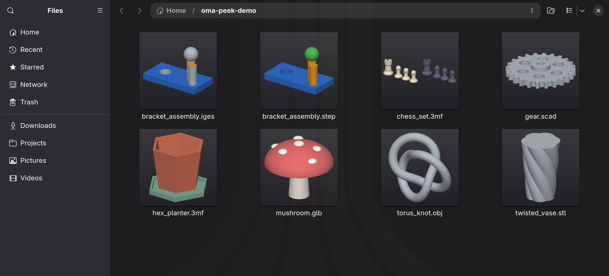
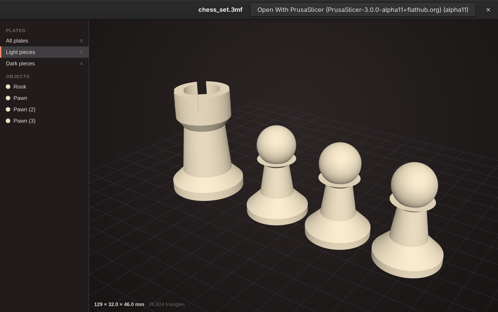
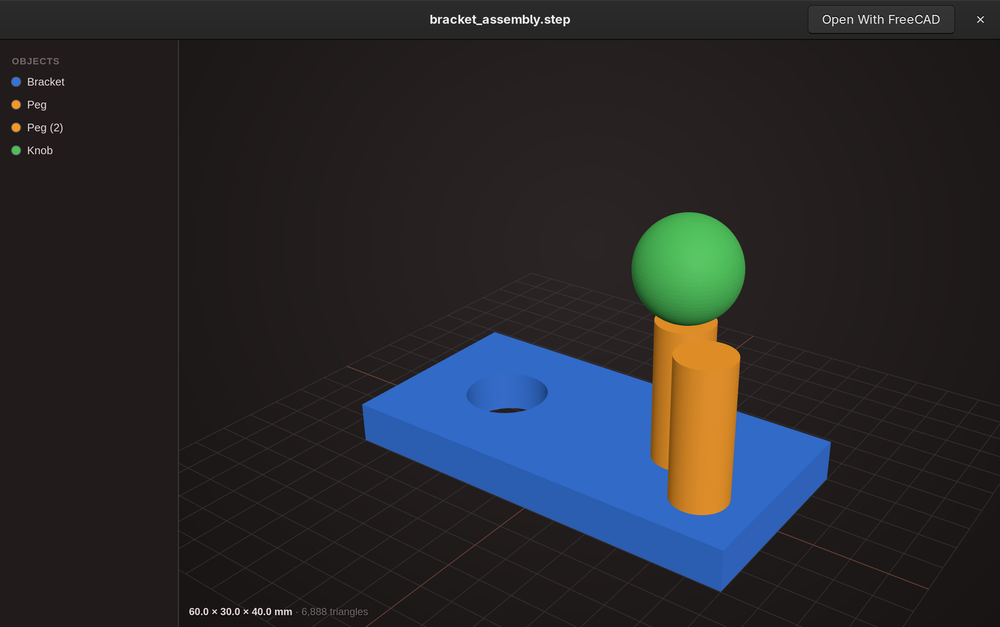
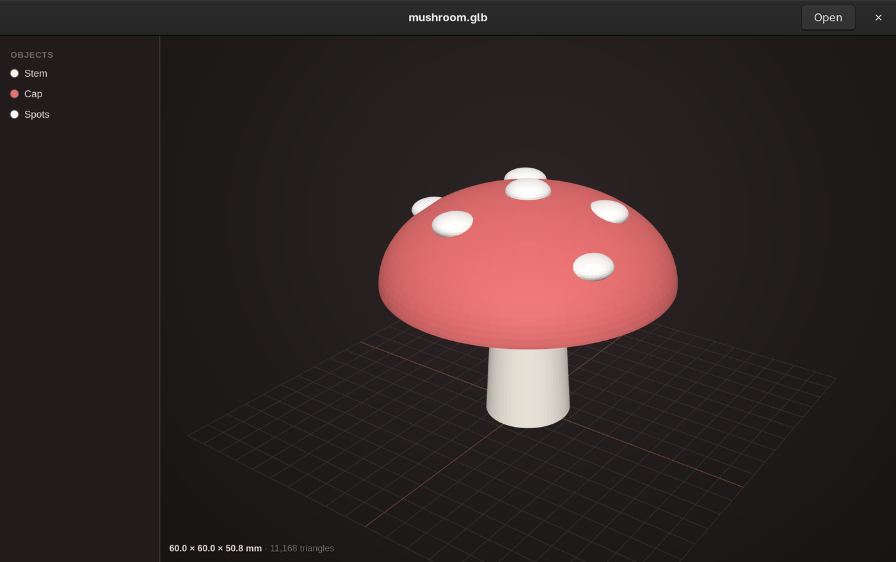

# oma-peek

Quick Look–style 3D previews for [Omarchy](https://omarchy.org): file thumbnails and
spacebar previews in Nautilus for STL, 3MF, OBJ, OpenSCAD, STEP, IGES and glTF/GLB.



Select a model in Nautilus and press <kbd>Space</kbd> to rotate, zoom and inspect it without
opening a slicer or CAD program:

| 3MF with plates | STEP assembly | glTF |
|---|---|---|
|  |  |  |

## Features

- **Thumbnails** in Nautilus's grid and list views, shaded with each part's colour.
  Multi-plate 3MF projects get a grid of their plates.
- **Spacebar preview** in Nautilus's built-in previewer (Sushi):
  - orbit, zoom and pan, with dimensions in mm and the triangle count
  - a plate picker for Bambu Studio / OrcaSlicer plates and PrusaSlicer multi-bed projects
  - an object list: hover highlights an object, click isolates it
  - slicer object names and filament colours from 3MF projects
  - colours follow your current Omarchy theme
- **Fast**: native C rendering, typically 0.1 s per thumbnail. A 1-million-triangle STL takes
  about 0.12 s and a 1-million-triangle 3MF about 0.4 s.
- **User-local**: installs into your home directory. No root, and no changes to system files.

| Format | Thumbnail | Preview | Colours and names |
|---|---|---|---|
| STL (binary and ASCII) | ✓ | ✓ | — |
| 3MF | ✓ | ✓ | PrusaSlicer, Bambu Studio, OrcaSlicer |
| OBJ | ✓ | ✓ | `.mtl` colours in the preview only |
| OpenSCAD `.scad` | ✓ | ✓ | — (rendered with `openscad`) |
| STEP `.step` `.stp` | ✓ | ✓ | part names and colours |
| IGES `.iges` `.igs` | ✓ | ✓ | some colours, no names |
| glTF `.glb` `.gltf` | ✓ | ✓ | mesh names and material colours |

PLY isn't supported yet: in practice PLY files are often point clouds or Gaussian splats,
which need their own handling.

## Install

oma-peek is an Omarchy shell plugin. Install it with the repository URL:

```sh
omarchy plugin add <repo-url> --enable
nautilus -q   # once, so Nautilus picks up the new thumbnailer
```

When the shell starts, the plugin builds and installs oma-peek if the code has changed, then
sends a notification. `omarchy plugin update oma-peek` fetches new versions.

Without the plugin system, clone the repository and run `./install.sh`.

### Requirements

Required (all in the Arch repositories):

- `nautilus` and `sushi` (Omarchy's file manager and its previewer)
- `gcc` and `python`

Optional:

| Package | Adds |
|---|---|
| `opencascade` | STEP, IGES and glTF support |
| `openscad` | `.scad` support |
| `libdeflate` | faster 3MF unzipping (falls back to zlib) |
| `python-numpy` | fallback renderer used only if the native library can't load |

```sh
sudo pacman -S --needed nautilus sushi gcc python opencascade openscad libdeflate
```

## Usage

Thumbnails appear automatically. In the spacebar preview:

| Input | Action |
|---|---|
| Drag | rotate |
| Scroll | zoom |
| Right-drag | pan |
| <kbd>R</kbd> | reset the view |
| <kbd>1</kbd>–<kbd>9</kbd>, <kbd>0</kbd> | show one plate, or all plates |
| <kbd>Space</kbd> | close |

To regenerate thumbnails Nautilus has already cached, delete them:

```sh
rm -rf ~/.cache/thumbnails/{normal,large,x-large,xx-large}/*
```

## Uninstall

```sh
omarchy plugin remove oma-peek
~/.local/share/oma-peek/uninstall.sh
```

Removing the plugin leaves the installed previews in place, so run `uninstall.sh` too.

## How it works

**Thumbnails.** GNOME runs thumbnailers in a `bwrap` sandbox that only exposes `/usr` and the
input and output files. So `install.sh` packs the Python thumbnailer and its compiled
libraries into the thumbnailer entry's `Exec` line, and `/usr/bin/python3` loads the libraries
from memory.

- `raster.c` → `libmeshraster.so`: parses STL and 3MF meshes, shades, rasterises,
  downsamples and composites. It's multithreaded and doesn't need numpy for the common formats.
- `cad.cpp` → `libmeshcad.so`: reads STEP, IGES, glTF and OBJ through OpenCASCADE, keeping
  part names, placements and colours, and meshes CAD surfaces with a tolerance relative to
  the model's size. It's loaded only for those formats.
- `thumbnailer.py`: format detection, 3MF project metadata (plates, objects, filament
  colours) and PNG output.

**Spacebar preview.** Sushi loads extra viewer modules from `~/.local/share/sushi/viewers/`.
`sushi/oma-peek.js` shows a three.js page (`web/`) in Sushi's WebKit view. SCAD and CAD files
are first converted to a mesh (`openscad`, or the `oma-peek-cad` converter built from
`cad.cpp`) and cached in `~/.cache/oma-peek/`.

Installed files:

- `~/.local/share/thumbnailers/oma-peek.thumbnailer`
- `~/.local/share/sushi/viewers/oma-peek.js`
- `~/.local/share/oma-peek/`: viewer page, `oma-peek-cad`, `uninstall.sh`
- `~/.cache/oma-peek/`: build directory and converted meshes

**Limitations.**

- Inside the thumbnail sandbox only the file itself is visible. OBJ `.mtl` colours and glTF
  files with separate `.bin` or texture files can't be read there; the spacebar preview isn't
  sandboxed and reads them. GLB is self-contained, so it's unaffected.
- The <kbd>R</kbd> and plate-number shortcuts only work when the 3D view has keyboard focus,
  and Sushi doesn't always give it focus when the preview opens.
- Very large STEP assemblies can take a few seconds to mesh the first time.

## Development

```sh
./install.sh            # build and install from this checkout
nautilus -q             # Nautilus reads the thumbnailer list only at startup
OMA_PEEK_DEBUG=1 /usr/lib/org.gnome.NautilusPreviewer   # previewer with logging; then: sushi FILE
```

- `bench/e2e/run.py` times the exact installed thumbnailer over a folder of models in
  `bench/e2e/data/` (not included). `bench/bench.c` and `bench/check_raster.sh` cover the
  raster library on its own.
- `docs/demo/make_demo.py OUT_DIR` generates the models used in these screenshots, from
  scratch, with OpenSCAD and OpenCASCADE.

The viewer bundles [three.js](https://threejs.org) and [fflate](https://github.com/101arrowz/fflate)
under the MIT licence (`web/vendor/LICENSE`).
